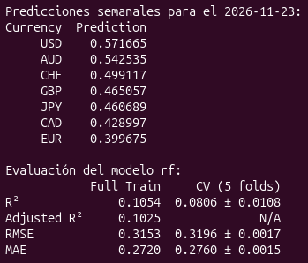
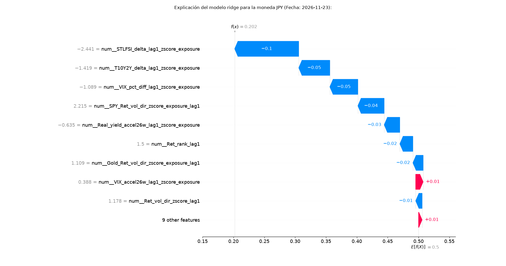
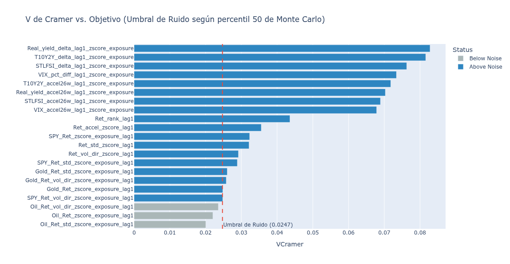
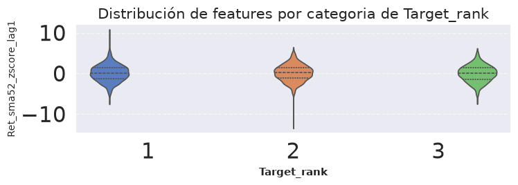
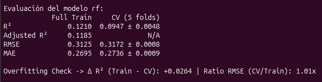
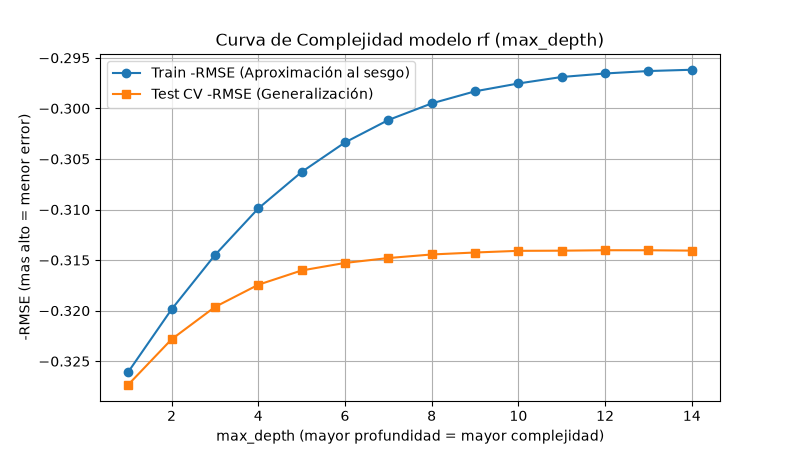
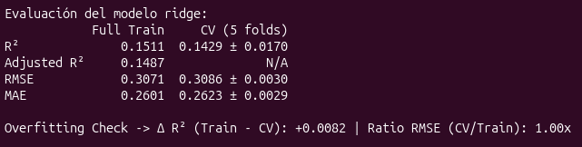
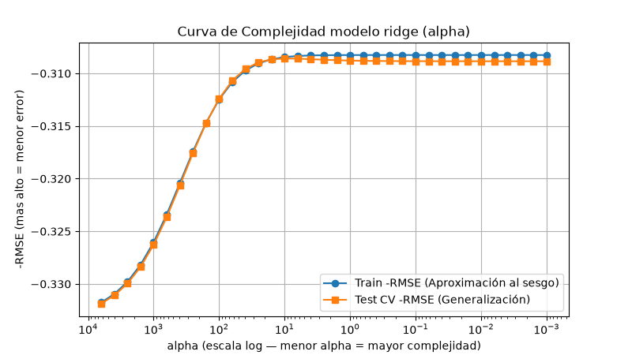

# 📊 ForexMiner


Este proyecto implementa un pipeline ETL (Extracción, Transformación y Carga) para construir un dataset financiero destinado al modelado predictivo, rankeando los retornos semanales de las principales divisas Forex:
* `USD`: el dólar de Estados Unidos.
* `EUR`: el euro.
* `AUD`: dólar australiano.
* `GBP`: libra británica.
* `JPY`: el yen japonés.
* `CAD`: el dólar canadiense.
* `CHF`: franco suizo.

El proyecto esta diseñado para realizar predicciones contemporáneas en t (semana en curso), luego de la apertura del lunes de los mercados de Nueva York. La ejecución durante el fin de semana permite evaluar las predicciones para la semana previa.

### Ejemplo de Predicciones (ranking descendente):


## 📊 Fases

El flujo cuenta con 3 fases principales de Extracción, Transformación y Modelado. Además existe una fase opcional de filtrado de variables y Notebooks de exploración de datos y evaluación de modelos:
### **Extracción** | `extract.py`: 
Obtención de datos a través de 2 APIs gratuitas: `yfinance` y `fred` (la segunda requiere obtener una clave api, se gestiona en la página oficial de la Reserva Federal: https://fred.stlouisfed.org/docs/api/api_key.html). Las intrucciones para ingresar tu clave en el repositorio local se encuentran en el fichero `src/data_sources.examples.py`.
### **Transformación** | `transform.py`: 
Sobre los datos crudos se aplica tratamiento de valores inválidos, alineaciones de fechas e imputación de valores perdidos. 

Se calculan los retornos por divisa a partir de los retornos de los pares Forex, obteniendo el retorno del USD de forma implícita. A partir de estos retornos se obtienen las caracteristicas, aplicando la exposición por divisa para cada variable macro y de otros activos (variables *no Forex*). El cálculo de las exposiciones permite relacionar dichas *features* con cada moneda, a fin de aplicar luego el modelado de la variable objetivo `Target_rank`, la cual calcula el ranking semanal de los retornos por divisa. 

Se estandarizan las variables mediante z-score exponencial. Finalmente se aplica lag sobre los predictores, desplazadas un período a fin de evitar el sesgo de anticipación (*Lookahead Bias*).
### **Modelado** | `modeling.py`:


Permite entrenar y analizar distintos modelos predictivos de regresión. Se selecciona el modelo a utilizar ingresando con el parámetro *"modelo"* el nombre correspondiente:

* **RandomForestRegressor**: `rf` (modelo por defecto)
* **ExtraTreesRegressor**: `et`
* **GradientBoostingRegressor**: `gbr`
* **Ridge**: `ridge`
* **ElasticNet**: `elasticnet`


El módulo incluye prueba de validación cruzada con partición de series temporales y evaluación de resultados para cualquiera de los modelos.

Además `eval_utils.py` contiene funciones auxiliares de ejecución independiente para la busqueda de hiper-parámetros óptimos, gráfico de curva de complejidad y explicabilidad de las predicciones con SHAP. Las mismas pueden ser ejecutadas en el notebook `evaluar_modelos.ipynb`.



### **Filtrado (opcional)**:
El módulo `filtering.py` detecta las variables que se encuentren por debajo de un umbral de ruído. Dicho umbral se define mediante la V de Cramer, calculando el valor percentil para una serie de variables aleatorias (por defecto la mediana de 100 variables *random*). Las variables que se encuentren por debajo del umbral se almacenan en el fichero `cols_filtrar.json`, y serán excluidas en las modelizaciones subsiguientes.



### **Análisis Exploratorio de Datos (EDA):**
El notebook `EDA.ipynb` permite realizar un análisis exploratorio de los datos transformados, incluyendo análisis de asimetrías, valores faltantes, gráficos de distribuciones, correlaciones y gráficos de violines representando las variables seleccionadas frente a la variable objetivo (agrupada en 3 clases para facilitar la visualización).



---
## 💻 Evaluación de modelos

### *RandomForestRegressor*


El modelado con *Random Forest* muestra un alto *bias*. A pesar de no mostrar sobreajuste y extraer señales de forma consistente, el poder predictivo es bajo, con varianza explicada promedio de apenas el 9 %. Este resultado es previsible dada la naturaleza ruidosa y no estacionaria de los datos financieros, asi como la disponibilidad limitada de datos gratuitos.

#### Curva de Complejidad:


* El error disminuye rápidamente desde `max_depth=1` `hasta max_depth=5`.
* A partir de `max_depth=5`, la curva de *test* se aplana. El ajuste en *train* sigue mejorando, aumentando la brecha. Casi toda la ganancia en entrenamiento en este tramo corresponde a memorización de patrones no generalizables.
* El punto óptimo se encuentra con una profundidad máxima entre 4 y 5, donde la brecha aún es baja. Aplicando además el Principio de Parsimonia, es preferible el modelo más simple, con `max_depth=4`, minimizando la memorización de interacciones espurias de variables.
---
### *Ridge*


Este modelo también muestra *underfitting*, con capacidad predictiva limitada aunque superior al *RandomForest*, con una varianza explicada en *test* por encima del 14%. 

#### Curva de Complejidad:


* La brecha entre entrenamiento y validación cruzada es mínima, mostrando una capacidad de generalización elevada y estable.
* Los errores tanto en entrenamiento como en test disminuyen rápidamente al reducir la regularización hasta `alpha = 100`.
* Se alcanza un pico en `alpha=10`, y a partir de este punto la curva de entrenamiento se aplana, mientras que el error en test se incrementa ensanchando la brecha. Este punto resulta óptimo, logrando con una regularización L2 moderada reducir la varianza sin sacrificar *bias*.

---
## 💻 Ejecución

Cada fase del proyecto cuenta con un modulo ejecutable desde el terminal:
- Fase de Extracción:

```bash
python -m src.extract
```
permite extraer los datos crudos comunes para todo el proyecto. Se almacenan en 2 ficheros tipo parquet dentro de la carpeta `/data/raw_data`.

- Fase de transformación:

```bash
python -m src.transform
```
Aplica la transformación de variables, generando el ficheros de datos limpios en la ruta `/data/clean_data`.


- Módulo de filtrado (opcional):
```bash
python -m src.filtering
```
Genera el fichero de columnas *"ruidosas"*, las cuales serán omitidas en la fase de modelado.

- Fase de modelado:
```bash
python -m src.modeling --evaluar --modelo ridge
```
Permite entrenar el modelo indicado. La inclusión del parámetro `--evaluar` habilita la evaluación del modelo mediante validación cruzada, exportando los resultados a un fichero .xlsx en la carpeta `evaluacion_modelos`.

- Ejecución del flujo completo:

El fichero `main.py` permite ejecutar de una sola vez el flujo completo:
```bash
python main.py
```


---
## 📊 Dataset y Variables

Se extraen de `yfinance` las series de precios semanales para los 6 pares forex base, asi como de los siguientes activos:

`SPY`: etf representando el índice de acciones en Estados Unidos.

`Oil`: precio futuro del petróleo.

`Gold`: precio futuro del oro.

Por otro lado, se extraen mediante la api Fred los siguientes datos macroeconómicos con granularidad diaria:
* `Real_yield_10y`: rendimiento real de los bonos del tesoro de USA a 10 años.
* `T10Y2Y`: spread entre los rendimientos de los bonos USA de 10 y 2 años.
* `VIX_index`: índice de volatilidad CBOE.
* `St_louis_financial_stress`: índice de estrés financiero de la Reseva Federal de St. Louis (datos publicados semanalmente).


---
## 🗂️ Estructura del repo

```text
FOREXMINER/
├── data/                            # Ubicación por defecto de los datos
│   ├── clean_data/                  # Datos depurados obtenidos en la transformación
│   ├── evaluations/                 # Contiene los resultados obtenidos en la evaluación
│   ├── predictions/                 # Predicciones completas por modelo para usar en Backtesting
│   ├── raw_data/                    # Datos crudos obtenidos de la extracción
│   ├── cols_filtrar.json            # Fichero que almacena el diccionario de columnas a excluir
├── notebooks/                       # Sub-directorio de notebooks
│   ├── EDA.ipynb                    # Análisis Exploratorio de Datos (EDA)
│   ├── evaluar_modelos.ipynb        # Evaluación y optimización de modelos
├── pictures/                        # Almacenamiento de imágenes para la documentación
├── src/                             # Sub-directorio con los módulos de funciones 
│   ├── __init__.py                  # Fichero vacío, inicializa la carpeta como paquete
│   ├── config.py                    # Configuración global del proyecto 
│   ├── data_sources.example.py      # Fichero ejemplo para gestionar la clave API de Fred
│   ├── eda_utils.py                 # Funciones para el notebook EDA
│   ├── eval_utils.py                # Funciones independientes para la evaluación de modelos
│   ├── extract.py                   # Módulo de la fase de extracción
│   ├── filtering.py                 # Módulo opcional para el filtrado de columnas
│   ├── modeling.py                  # Módulo de la fase de modelado
│   └── transform.py                 # Módulo de la fase transformación
├── .gitignore                       # Reglas de git ignore
├── main.py                          # Programa para ejecutar el flujo completo
├── LICENSE                          # Licencia del proyecto
├── README.md                        # Descripción del proyecto
└── requirements.txt                 # Dependencias necesarias
```

---
## 🚀 Requisitos e Instalación

1. Clona este repositorio en tu máquina local:
   ```bash
   git clone https://github.com/sebakremis/ForexMiner.git
   cd ForexMiner
   ```

* Antes de instalar las librerías, se recomienda crear un entorno virtual específico.

2. Instala el entorno de dependencias requerido utilizando `pip`:
   ```bash
   pip install -r requirements.txt
   ```

---
## 📜 Licencia
Este repositorio se encuentra bajo una licencia de código abierto **MIT**. 
Puedes usar, modificar y distribuir el código libremente para cualquier propósito. Para obtener más información, consulta el archivo [LICENCIA MIT](LICENSE).

*ForexMiner* se desarrolla estrictamente con fines de **práctica** de Minería de Datos, sin proporcionar asesoramiento financiero ni recomendaciones de inversión.
